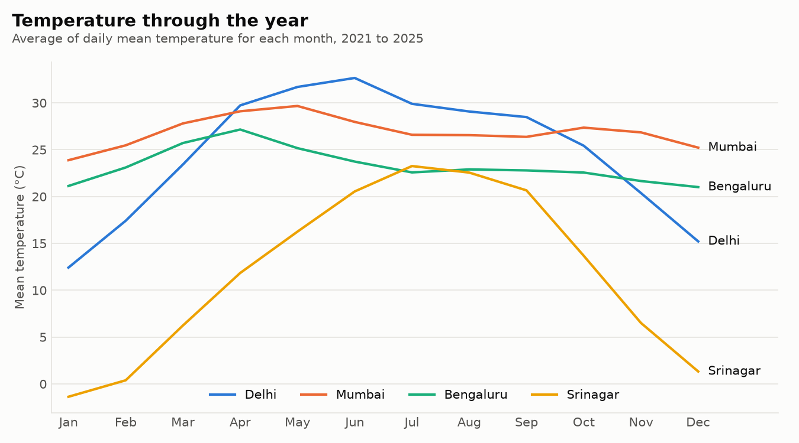
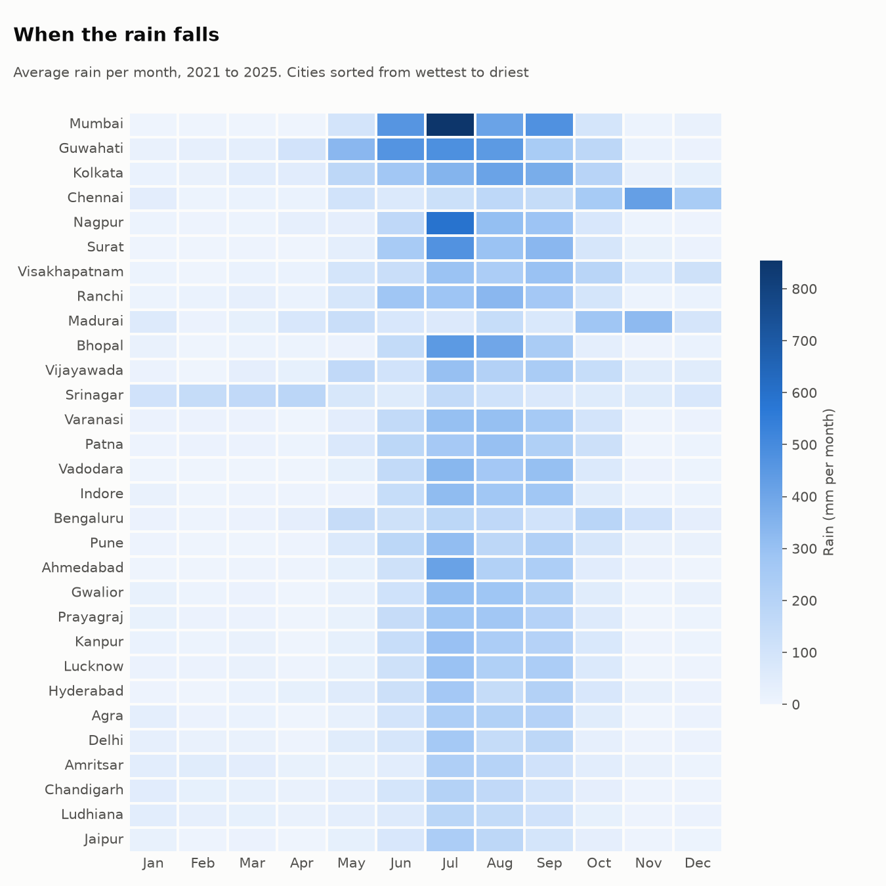
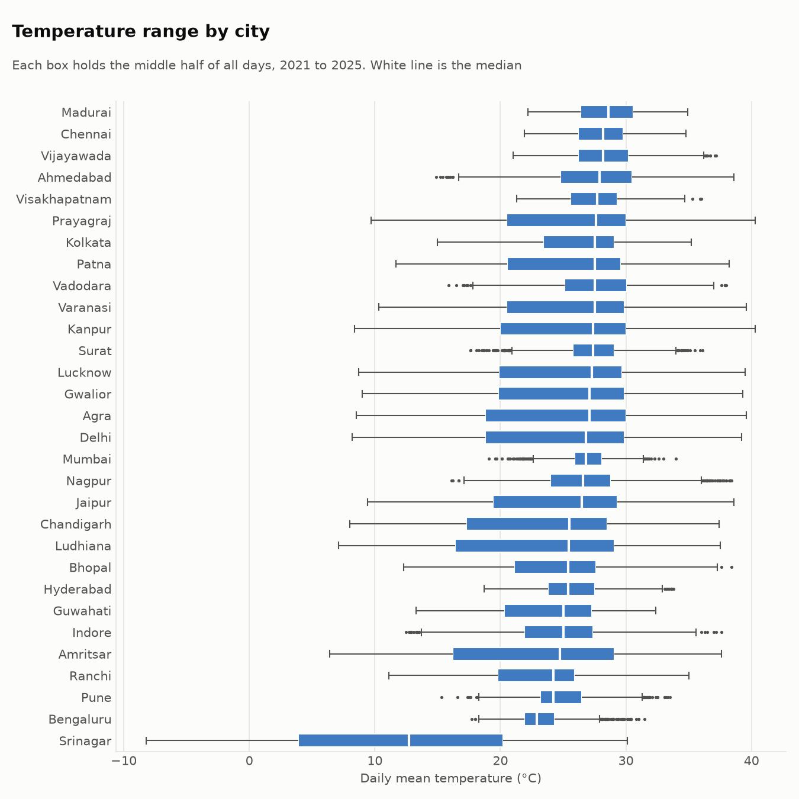
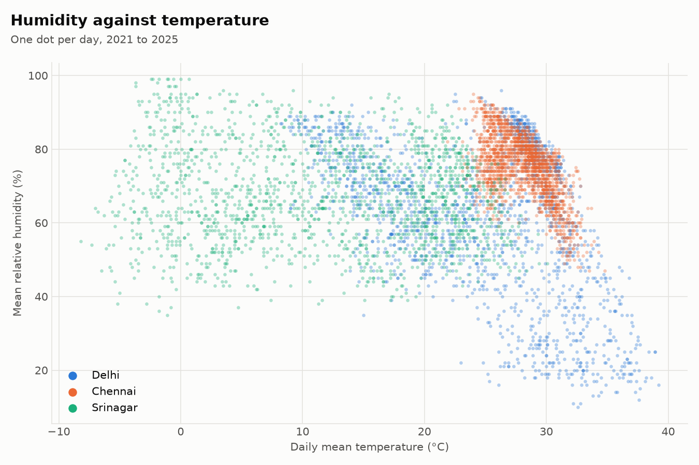
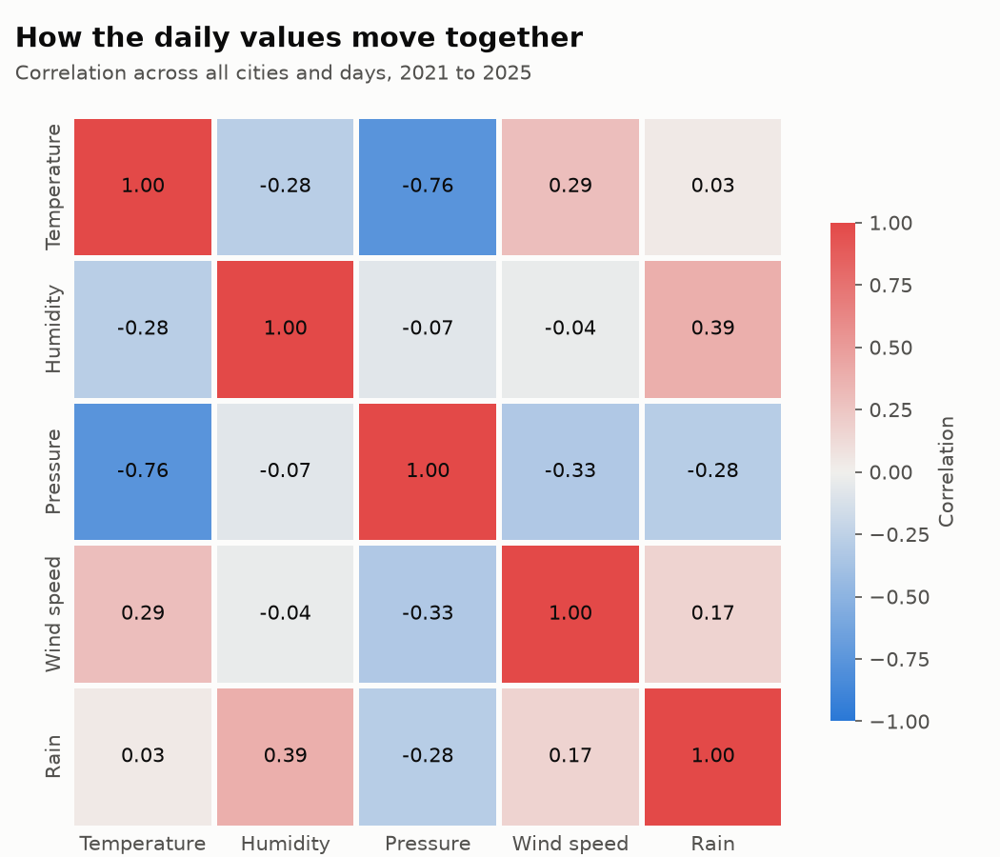

# Weather Data Visualization

Five years of daily weather for 30 Indian cities, cleaned with pandas and drawn as seven charts.

## What it does

The scripts download daily weather for 30 cities from January 2021 to December 2025 and tidy it into one table of 54,780 rows. From that table they draw charts that compare the cities: how temperature moves through the year, when the rain falls, and how temperature, humidity, pressure, wind and rain relate to each other. The same table loads into Tableau without further changes.

## Why we built it

This is our undergraduate data visualization project.

## What the data shows

Every number below is printed by `scripts/summary.py`.



Inland cities in the north swing the most. Delhi averages 12.4 °C in January and 32.7 °C in June. Srinagar has the widest gap between its coolest and warmest month, 24.6 °C. Madurai has the narrowest, 5.2 °C.



Across all 30 cities, 74% of the rain falls between June and September. Mumbai is the wettest city at about 2,434 mm a year, with 855 mm in an average July. Jaipur is the driest at about 696 mm. Chennai and Madurai follow a different calendar and get more than half of their rain from October to December.



Madurai is the warmest city on average (28.5 °C) and Srinagar the coolest (11.9 °C). Coastal cities such as Mumbai and Chennai stay inside a narrow band all year. Cities on the northern plains spread much wider: Delhi's daily mean runs from 8.2 °C to 39.2 °C.



Chennai stays warm and humid on almost every day. Delhi's hottest days are also its driest, which is the pre-monsoon heat of April to June.



Temperature and sea-level pressure move in opposite directions (correlation -0.76). Humid days are more often rainy days (0.39). Temperature and rain show almost no link when all cities are pooled (0.03).

Two more charts are in `charts/`: the distribution of daily temperature, and the share of days by weather type.

## Tech stack

Python 3.12, pandas, matplotlib, seaborn and requests. Tableau is optional.

## How it works

| Script | What it does |
|---|---|
| `scripts/fetch_data.py` | Asks the Open-Meteo API for each city in `data/cities.csv` and saves `data/raw/weather_daily.csv` |
| `scripts/clean_data.py` | Renames columns, adds year, month, season and a weather label, checks for gaps, and saves `data/processed/weather_clean.csv` |
| `scripts/make_charts.py` | Draws the seven PNG files in `charts/` |
| `scripts/summary.py` | Prints the figures quoted in this README |

The download script saves after each city. If the connection drops it carries on from the last city it finished.

## Run it locally

The downloaded data is already in the repository, so the download step can be skipped.

```bash
python -m venv .venv
.venv\Scripts\activate
pip install -r requirements.txt
python scripts/clean_data.py
python scripts/make_charts.py
python scripts/summary.py
```

On macOS or Linux, activate with `source .venv/bin/activate`.

To download the data again, delete `data/raw/weather_daily.csv` and run `python scripts/fetch_data.py`. It takes about eight minutes because the free API limits how fast it can be called.

For Tableau, open `data/processed/weather_clean.csv` as a text file data source. It has latitude and longitude for maps.

## Data source

Weather data comes from the [Open-Meteo Historical Weather API](https://open-meteo.com/en/docs/historical-weather-api), which is free for non-commercial use and published under [CC BY 4.0](https://open-meteo.com/en/license).

## Status and limitations

The four scripts run from start to finish and the charts above come from them.

- The values are reanalysis estimates for the grid cell nearest each city. They are produced by a weather model and are not weather station readings, so extremes can differ from official records.
- The weather label is the most severe condition the model reported that day, which is why drizzle appears so often.
- Five years is too short to say anything about climate trends.
- The 30 cities are mostly large ones. Kerala, the Himalayan states other than Kashmir, and the north-east apart from Guwahati are not covered.
- There is no Tableau workbook in the repository yet, only the data file prepared for it.
- There are no automated tests.

## Authors

Sourav Kumar and Avijit Sakkarwal

## Licence

The code is under the MIT licence, see [LICENSE](LICENSE). The weather data keeps the Open-Meteo licence named above.
