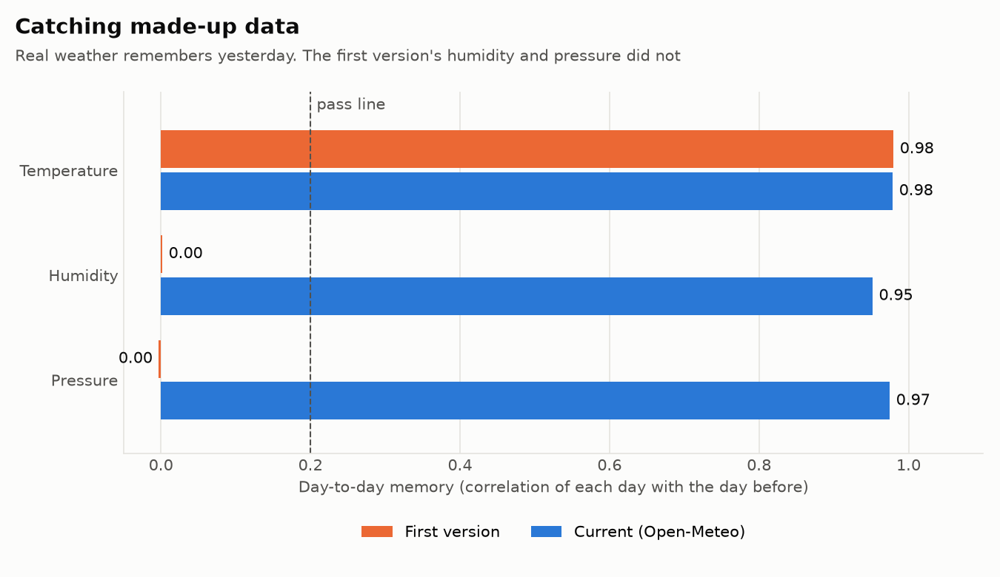
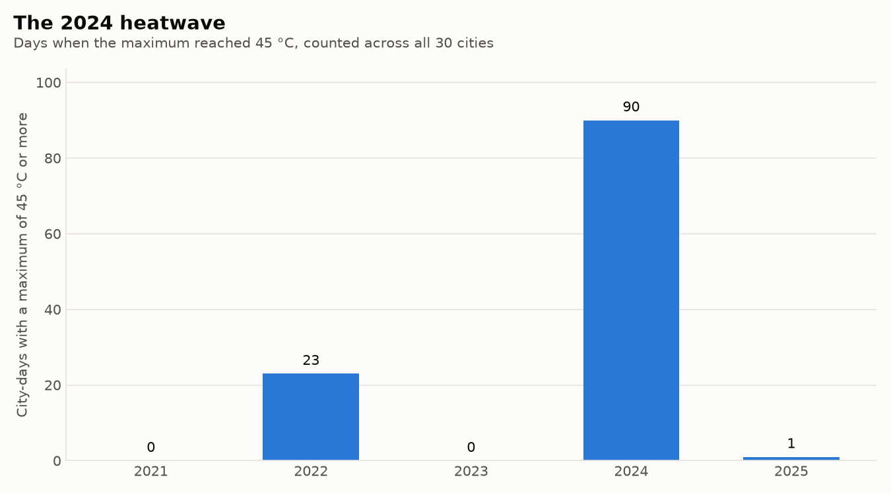
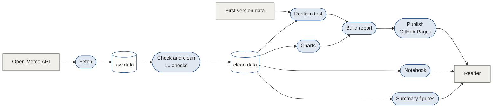

# Five Years of Indian Weather

A Python data pipeline and analysis of daily weather in 30 Indian cities from 2021 to 2025. It checks the data, tests whether it is real, compares the results with official records, and publishes a report with a city lookup.

[Read the report](https://developwithsourav.github.io/Weather-Data-Visualization/) · [Analysis notebook](notebooks/analysis.ipynb) · [Download the data](https://github.com/developwithsourav/Weather-Data-Visualization/releases/latest) · [Data flow](docs/data-flow.md) · [What's next](docs/roadmap.md)

## At a glance

| | |
|---|---|
| Problem | Weather data is easy to download and easy to get wrong. The first version of this project drew charts from a dataset whose humidity and pressure turned out to be random numbers. |
| What we built | A pipeline that downloads five years of daily weather, checks every row, tests each variable for signs of made-up data, draws the charts, and publishes a report, all from one command. |
| Data | 54,780 daily records: 30 cities, 1 January 2021 to 31 December 2025, from the Open-Meteo Historical Weather API |
| Results | 10 findings with charts, 7 of them compared with official figures from the India Meteorological Department (IMD) |
| Stack | Python 3.12, pandas, matplotlib, seaborn, pytest, Jupyter, GitHub Actions, GitHub Pages, plain JavaScript |
| Quality | 10 data checks on every run, 10 automated tests, and outputs that rebuild identically from the raw data |

## The problem we solved

The first version of this project, from May 2025, used a downloaded dataset of Indian weather. Its charts looked reasonable. Looking closer, Srinagar was as humid as Mumbai, and Mumbai's humidity did not rise in the monsoon.

Real weather has habits that random numbers do not. Today is close to yesterday, the month of the year explains much of the variation, and cities differ from each other by more than chance. We scored each variable on all three.



| Dataset | Variable | Memory | Seasons | Cities differ | Verdict |
|---|---|---:|---:|---:|---|
| First version | Temperature | 0.98 | 0.84 | 0.49 | looks real |
| First version | Humidity | 0.00 | 0.00 | 0.02 | **looks random** |
| First version | Pressure | 0.00 | 0.00 | 0.02 | **looks random** |
| Current | Humidity | 0.95 | 0.67 | 0.34 | looks real |
| Current | Pressure | 0.97 | 0.82 | 0.24 | looks real |

The old humidity and pressure score the same as numbers drawn at random. So we rebuilt the project on data from Open-Meteo, where every variable passes, and made the test part of the pipeline: `scripts/realism_check.py`, with tests in `tests/test_checks.py`.

## What we found

Every number here is printed by `scripts/summary.py`. The [report](https://developwithsourav.github.io/Weather-Data-Visualization/) covers each one in full, with sources.

| Finding | Our data | Official record |
|---|---|---|
| Share of rain from June to September | 74% across the 30 cities | about 75% nationally (IMD) |
| Tamil Nadu's rain comes late | Chennai 57%, Madurai 51% from October to December | 48% for Tamil Nadu (IMD Chennai) |
| 2024 heatwave | 90 city-days at 45 °C or more, against 23 in 2022 | IMD stations hit 50.5 °C on 28 May 2024 |
| Model against thermometer | Delhi 45.8 °C on 28 May 2024 | 49.9 °C at an IMD station in Delhi that day |
| Warming | average rose every year, 24.93 °C to 25.46 °C | 2024 was India's warmest year since 1901 (IMD) |
| 2024 monsoon | 16% above our five-year average | 108% of the long period average (IMD) |
| Where they disagree | Guwahati 23% above its average in 2024 | north-east India at 86% of normal (IMD) |

Three more come from our data alone. Madurai, Chennai and Mumbai stay within six degrees between their warmest and coolest month, while Srinagar spans 24.6. Sea-level pressure falls 14 hPa from January to July as the land heats. And a third of a year's rain falls on its ten wettest days.




## How the data flows



[docs/data-flow.md](docs/data-flow.md) has the full level 0 and level 1 data flow diagrams, what each step reads and writes, the 10 checks, and a dictionary of every column.

## Where to look

| To see | Open |
|---|---|
| Data download with retries and resume | [scripts/fetch_data.py](scripts/fetch_data.py) |
| Cleaning and data validation | [scripts/clean_data.py](scripts/clean_data.py) |
| The realism test | [scripts/realism_check.py](scripts/realism_check.py) |
| Charts with matplotlib and seaborn | [scripts/make_charts.py](scripts/make_charts.py) |
| Analysis step by step, with observations | [notebooks/analysis.ipynb](notebooks/analysis.ipynb) |
| Tests | [tests/test_checks.py](tests/test_checks.py) |
| One-command pipeline | [run_all.py](run_all.py) |
| CI and publishing | [.github/workflows/report.yml](.github/workflows/report.yml) |
| Report page and city lookup | [site/index.html](site/index.html) |

## Try it in two minutes

You need Python 3.12 and git. The data is already in the repository, so nothing is downloaded.

```bash
git clone https://github.com/developwithsourav/Weather-Data-Visualization
cd Weather-Data-Visualization
python -m venv .venv
.venv\Scripts\activate
pip install -r requirements-dev.txt
python run_all.py --serve
```

On macOS or Linux, activate with `source .venv/bin/activate`. The last command takes about 15 seconds. It prints the 10 data checks, the realism verdicts, every figure in this README and the test results, then opens the report at `http://localhost:8000`. Press Ctrl+C to stop it.

Other ways to run it:

- `python run_all.py` builds everything without starting a server.
- `python -m pytest` runs only the tests.
- `jupyter notebook notebooks/analysis.ipynb` opens the notebook.
- `python scripts/fetch_data.py` downloads the data again after you delete `data/raw/weather_daily.csv`. It takes about eight minutes because the free API limits how fast it can be called.

## Project structure

```
data/
  cities.csv               30 cities with coordinates
  raw/                     the download, as received
  processed/               cleaned data and realism scores
  first_version/           humidity, pressure and temperature from the first version
scripts/                   one script per step
notebooks/analysis.ipynb   the analysis with code and observations
tests/                     tests for the checks and the realism test
charts/                    11 charts used by the README and report
site/index.html            the report page
docs/                      data flow and roadmap
run_all.py                 runs every step and the tests
```

## Limits

- The values are model estimates for a grid cell, not weather station readings, so they understate local extremes.
- The weather label is the most severe condition the model reported that day, which is why drizzle appears often.
- Five years is enough to compare cities and spot unusual years, not to measure climate trends.
- The 30 cities leave out Kerala, most of the Himalaya and most of the north-east.
- The Tableau dashboard from the first version has not been rebuilt on the new data.

## What's next

The three improvements that would add most are measuring the model against weather station records, refreshing the data every month on a schedule, and turning the realism test into a reusable tool. [docs/roadmap.md](docs/roadmap.md) lists these and twelve more.

## Data source

Weather data from the [Open-Meteo Historical Weather API](https://open-meteo.com/en/docs/historical-weather-api), free for non-commercial use under [CC BY 4.0](https://open-meteo.com/en/license). Official figures are from IMD reports, listed with links in the report.

## Authors

Sourav Kumar and Avijit Sakkarwal

## Licence

The code is under the MIT licence, see [LICENSE](LICENSE). The weather data keeps the Open-Meteo licence.
