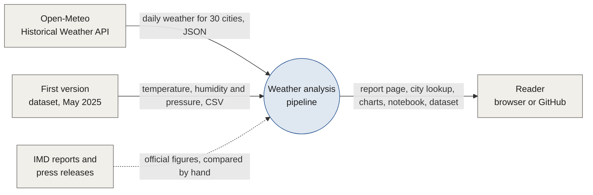
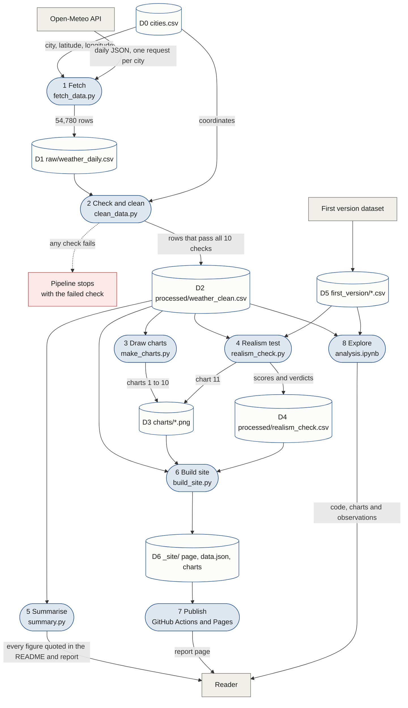

# How the data flows

This page follows the data from the weather API to the published report. It has two data flow diagrams, a list of the files that hold data between steps, the checks that guard each step, and a dictionary of every column.

## Level 0: the whole system

The project takes data from two sources, checks and analyses it, and hands four things to the reader. IMD reports are read by hand and quoted in the text; no code downloads them.

## Level 1: inside the pipeline

Rounded boxes are processes, cylinders are files that hold data between steps, and grey boxes are outside the project. `run_all.py` runs processes 2 to 6 in order, then the tests.

## Processes

| # | Process | Reads | Writes | What can stop it |
|---|---|---|---|---|
| 1 | Fetch | D0, Open-Meteo API | D1 | Five failed attempts for one city. A rerun keeps the cities already saved |
| 2 | Check and clean | D1, D0 | D2 | Any of the 10 data checks below |
| 3 | Draw charts | D2 | D3 | A missing D2 |
| 4 | Realism test | D2, D5 | D4, D3 | A missing D2 or D5 |
| 5 | Summarise | D2 | printed figures | A missing D2 |
| 6 | Build site | D2, D3, D4, `site/index.html` | D6 | A missing D2 |
| 7 | Publish | D6 | the live page | Any earlier step or test failing in GitHub Actions |
| 8 | Explore | D2, D5 | the notebook's outputs | Nothing; it is run by hand |

## Data stores

| Store | File | Rows | Kept in git | Made by |
|---|---|---|---|---|
| D0 | `data/cities.csv` | 30 | yes | written by hand from the first version's city list |
| D1 | `data/raw/weather_daily.csv` | 54,780 | yes, so nobody has to download | process 1 |
| D2 | `data/processed/weather_clean.csv` | 54,780 | yes, so Tableau users can open it | process 2 |
| D3 | `charts/*.png` | 11 files | yes, so the README shows them | processes 3 and 4 |
| D4 | `data/processed/realism_check.csv` | 8 | yes | process 4 |
| D5 | `data/first_version/*.csv` | 3,652 days each | yes, so the realism test can be repeated | copied from the first version |
| D6 | `_site/` | 1 page, 1 JSON file, 11 charts | no, rebuilt every run | process 6 |

## Checks in process 2

The cleaning script counts the rows that break each rule. Any count above zero stops the pipeline before a chart is drawn.

| Check | Rule |
|---|---|
| Missing values | no empty cell in any column |
| Duplicates | one row per city per date |
| Complete calendar | every city has every day from the first date to the last |
| Temperature order | minimum is not above maximum |
| Mean temperature | mean lies between minimum and maximum |
| Humidity | between 0 and 100% |
| Rain | never negative |
| Pressure | between 900 and 1,100 hPa |
| Wind direction | between 0 and 360 degrees |
| Weather code | every code has a label |

## Data dictionary

Columns of `data/processed/weather_clean.csv`, one row per city per day.

| Column | Type | Unit | Meaning | From |
|---|---|---|---|---|
| `city` | text | | City name | `cities.csv` |
| `date` | date | | Day, Indian Standard Time | API `time` |
| `temp_mean_c` | number | °C | Mean air temperature at 2 m | API `temperature_2m_mean` |
| `temp_max_c` | number | °C | Highest temperature of the day | API `temperature_2m_max` |
| `temp_min_c` | number | °C | Lowest temperature of the day | API `temperature_2m_min` |
| `humidity_pct` | whole number | % | Mean relative humidity at 2 m | API `relative_humidity_2m_mean` |
| `pressure_hpa` | number | hPa | Mean pressure reduced to sea level | API `pressure_msl_mean` |
| `wind_speed_kmh` | number | km/h | Mean wind speed at 10 m | API `wind_speed_10m_mean` |
| `wind_direction_deg` | whole number | degrees | Dominant wind direction at 10 m | API `wind_direction_10m_dominant` |
| `rain_mm` | number | mm | Total precipitation | API `precipitation_sum` |
| `weather_code` | whole number | WMO code | Most severe weather of the day | API `weather_code` |
| `year` | whole number | | Calendar year | from `date` |
| `month` | whole number | | 1 to 12 | from `date` |
| `season` | text | | Winter, Pre-monsoon, Monsoon or Post-monsoon, as IMD defines them | from `month` |
| `weather` | text | | Readable label for `weather_code`, such as Drizzle | from `weather_code` |
| `latitude` | number | degrees | City latitude | `cities.csv` |
| `longitude` | number | degrees | City longitude | `cities.csv` |
